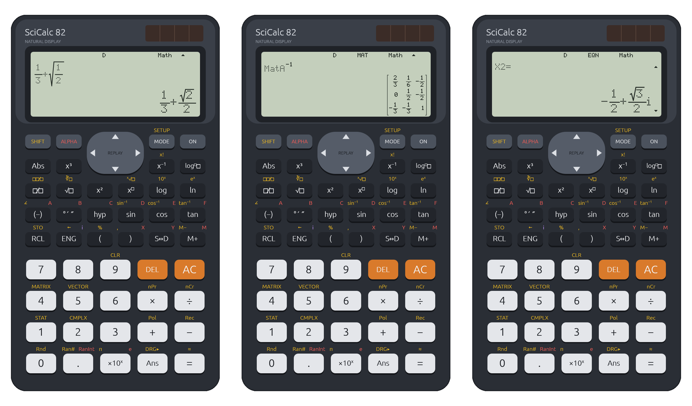
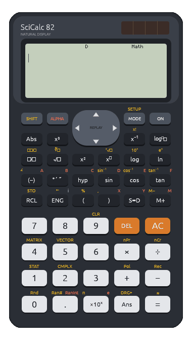

<div align="center">


# SciCalc 82

**A scientific calculator with a textbook display and exact answers, built in Rust 🦀**

It looks, feels and calculates like a classic school scientific calculator,<br>
and runs on Windows, macOS, Linux and in the browser.

[](https://github.com/abdullah-alahmadi/scicalc82/actions/workflows/ci.yml)
[](https://github.com/abdullah-alahmadi/scicalc82/releases/latest)
[](LICENSE)
[](https://www.rust-lang.org)

[**Download**](#download) &nbsp;·&nbsp; [**Try it in your browser**](https://abdullah-alahmadi.github.io/scicalc82/) &nbsp;·&nbsp; [**User Manual**](docs/USER_MANUAL.md)

<br>



</div>

<br>

## Exact, like on paper

Answers stay as fractions, square roots and multiples of π for as long as they can. `sin 30°` is `1/2`, `cos(π/4)` is `√2/2`, and `1/3 + √(1/2)` is shown just as you would write it. Press **S⇔D** whenever you want the decimal.

<p align="center">
  
</p>

## Seven modes

| Mode | What it does | For example |
|---|---|---|
| **COMP** | Everyday calculations: trig, logs, powers and roots, factorials, nPr and nCr, degrees-minutes-seconds | `sin⁻¹(1/2)` → `π/6` in radians |
| **CMPLX** | Complex numbers in rectangular and polar form | `2∠30` → `√3+i` |
| **STAT** | One-variable statistics and linear regression, with a data editor | mean, σx, and predicted values from the regression line |
| **TABLE** | A table of values of f(X) over a range | `X²+1` for X = 1 to 5 |
| **MATRIX** | Matrices up to 3×3 with exact inverse, determinant and transpose | `[[1,2],[3,4]]⁻¹` → `[[−2,1],[3/2,−1/2]]` |
| **EQN** | Simultaneous linear equations, quadratics and cubics, with complex roots | `X³−1=0` → `1`, `−1/2 ± √3/2 i` |
| **VECTOR** | 2D and 3D vectors: dot and cross products, length and angle | the length of (1, 2, 3) → `√14` |

<table>
  <tr>
    <td align="center" width="33%"><br><sub>Polar form, exactly</sub></td>
    <td align="center" width="33%"><br><sub>A matrix inverse</sub></td>
    <td align="center" width="33%"><br><sub>A cross product</sub></td>
  </tr>
  <tr>
    <td align="center"><br><sub>Complex roots of a cubic</sub></td>
    <td align="center"><br><sub>Linear regression</sub></td>
    <td align="center"><br><sub>A table of values</sub></td>
  </tr>
</table>

## The details

- **A natural display.** Fractions stack, roots stretch over what they contain, and exponents are raised. The cursor moves through all of it, and LineIO gives a one-line display instead.
- **A real dot-matrix LCD.** Display text is drawn dot by dot from the app's own 5×7 typeface, snapped to screen pixels so even small text stays sharp.
- **The calculator's rules.** It follows the device's order of operations, including implicit multiplication. Errors put the cursor where the problem is, and ▲/▼ replay earlier calculations.
- **Memory that lasts.** Ans, the variables A–F, X, Y and M, your settings and the data in every mode are kept between launches.
- **Your keyboard works too.** Type digits and operators, use `s` for sin, `r` for √, `f` for a fraction and more. See the [shortcuts](docs/USER_MANUAL.md#11-pc-keyboard-shortcuts).

Everything is explained, with screenshots, in the [**User Manual**](docs/USER_MANUAL.md).

## Download

Get the installer for your system from the [**latest release**](https://github.com/abdullah-alahmadi/scicalc82/releases/latest):

| System | File | |
|---|---|---|
| **Windows** 10 and 11 | `…_x64-setup.exe` or `…_arm64-setup.exe` | Installs for your account; no administrator rights needed |
| **macOS** 11 and later | `…_aarch64.dmg` (Apple silicon) or `…_x64.dmg` (Intel) | Drag the app to Applications |
| **Debian, Ubuntu** | `….deb` | `sudo apt install ./scicalc82_*.deb` |
| **Fedora, RHEL** | `….rpm` | `sudo dnf install ./scicalc82-*.rpm` |

Or skip installing and [use it in your browser](https://abdullah-alahmadi.github.io/scicalc82/).

> [!NOTE]
> The installers aren't code-signed yet. On Windows, if SmartScreen appears, choose *More info → Run anyway*. On macOS, right-click the app and choose *Open* the first time.

## Build from source

With a recent stable [Rust](https://rustup.rs) toolchain:

```bash
git clone https://github.com/abdullah-alahmadi/scicalc82.git
```

```bash
cd scicalc82
```

```bash
cargo run --release -p calc-app
```

[docs/BUILDING.md](docs/BUILDING.md) covers the web version, the installers and the tests.

## Built with Rust

SciCalc 82 is written entirely in safe [Rust](https://www.rust-lang.org): about 11,000 lines, with `unsafe` code forbidden across the workspace. It's split into two crates.

- **`calc-core`** is the calculator itself: exact arithmetic, the input editor, the parser and every mode. The fractions, square roots and π multiples are implemented from scratch, so the engine's only dependencies are `serde` (for saving) and `thiserror`. It has no UI code, and everything happens through one call, `Calculator::press(key)`.
- **`calc-app`** draws the body, the keys and the dot-matrix LCD with [egui](https://github.com/emilk/egui) and [eframe](https://github.com/emilk/egui/tree/main/crates/eframe). The same code builds a native app for Windows, macOS and Linux and, through [WebAssembly](https://webassembly.org) and [trunk](https://trunkrs.dev), the browser version.

Because the engine only takes key presses, whole keystroke sequences are easy to test. Most of the more than 140 tests read like button presses, and [proptest](https://github.com/proptest-rs/proptest) checks the arithmetic against random inputs. Even the pictures on this page are rendered by tests, offscreen, from the real app.

| | |
|---|---|
| Language | Rust 2024 edition, stable toolchain |
| UI | egui and eframe, drawn with OpenGL (glow) |
| Web | WebAssembly, built with trunk |
| Installers | [cargo-packager](https://github.com/crabnebula-dev/cargo-packager) and [cargo-generate-rpm](https://github.com/cat-in-136/cargo-generate-rpm) |
| Tests | Keystroke tests, property tests with proptest, and offscreen renders with egui_kittest |

## License

SciCalc 82 is released under the [MIT License](LICENSE).
