# SciCalc 82 User Manual

SciCalc 82 is a scientific calculator for the desktop and the web, modeled on the classic school scientific calculators. It writes math the way a textbook does, keeps answers exact when it can, and has modes for complex numbers, statistics, tables of values, matrices and equations.

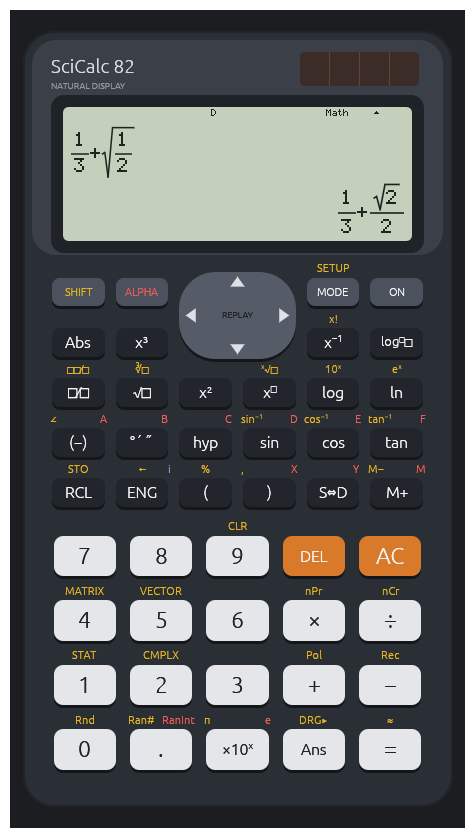

## Contents

1. [Getting started](#1-getting-started)
2. [Typing calculations](#2-typing-calculations)
3. [Reading results](#3-reading-results)
4. [Functions](#4-functions)
5. [Memory](#5-memory)
6. [SETUP: display and angle settings](#6-setup-display-and-angle-settings)
7. [Modes](#7-modes)
   - [COMP](#71-comp-everyday-calculations)
   - [CMPLX: complex numbers](#72-cmplx-complex-numbers)
   - [STAT: statistics and regression](#73-stat-statistics-and-regression)
   - [TABLE: tables of values](#74-table-tables-of-values)
   - [MATRIX: matrices](#75-matrix-matrices)
   - [EQN: equations](#76-eqn-equations)
   - [VECTOR: vectors](#77-vector-vectors)
8. [Error messages](#8-error-messages)
9. [Saved state and resetting](#9-saved-state-and-resetting)
10. [Key reference](#10-key-reference)
11. [PC keyboard shortcuts](#11-pc-keyboard-shortcuts)
12. [Specifications](#12-specifications)

---

## 1. Getting started

### Starting the calculator

- **Desktop:** run `calc-app.exe` (or `cargo run --release -p calc-app` from the project folder). The window can be resized; the calculator keeps its shape.
- **Web:** open the web build in a browser (see the README for building it). It behaves the same as the desktop version.

### The keys and their colors

Most keys do up to three things:

- **The white or dark label on the key** is what it does when you press it.
- **The gold label above the key** is what it does after you press **SHIFT**.
- **The red label above the key** is what it does after you press **ALPHA**. These are mostly the memory letters A–F, X, Y and M.
- **A purple label** marks what a key does in a particular mode. The only one is **i** next to ENG, which types the imaginary unit in CMPLX mode.

Press **SHIFT** or **ALPHA** once, then the key. The SHIFT or ALPHA key lights up while it's active, and pressing it again cancels it.

The round pad near the top is **REPLAY**: its four arrows move the cursor and step through earlier calculations.

### The display

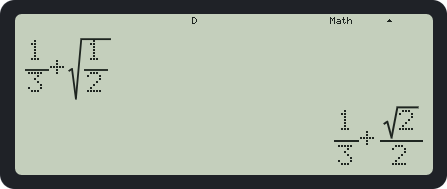

The top line of the display holds small **indicators**:

| Indicator | Meaning |
|---|---|
| **S** / **A** | SHIFT or ALPHA is active |
| **M** | The independent memory M is not zero |
| **STO** / **RCL** | Waiting for a variable key to store to, or recall from |
| **hyp** | Waiting for sin, cos or tan to make it hyperbolic |
| **D** / **R** / **G** | The angle unit: degrees, radians or grads |
| **FIX** / **SCI** | A fixed number of decimal places, or scientific notation, is set |
| **STAT** / **CMPLX** / **MAT** / **EQN** / **VCT** | The current mode (nothing is shown in COMP and TABLE) |
| **Math** | Natural (textbook) display is on |
| **▲** | Earlier calculations can be replayed with ▲ |

Below the indicators, the **input** sits at the top left and the **result** at the bottom right.

---

## 2. Typing calculations

### Entering and evaluating

Type a calculation with the keys and press **=**. For example, **1 + 2 × 3 =** shows `7`.

You don't need to close parentheses at the end: `sin(30` is read as `sin(30)`.

### Textbook-style templates

Several keys insert a *template*: a fraction, root or power with boxes to fill in. An empty box shows as a small square. The cursor starts in the first box. **→** moves to the next box, or out of the template when you're in the last one; **←** moves back.

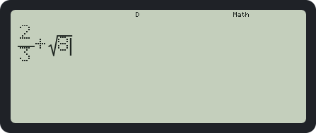

| Key | Template |
|---|---|
| **□/□** | A fraction. If you've just typed a number, it becomes the numerator. |
| SHIFT **□/□** | A mixed fraction, such as 1 ½ |
| **√□** | A square root |
| SHIFT **√□** | A cube root |
| **x^□** | A power of what comes before it |
| SHIFT **x^□** | A root with any index, ˣ√ |
| SHIFT **log** | 10 to a power |
| SHIFT **ln** | e to a power |
| **log□□** | A logarithm to any base |
| **Abs** | An absolute value |

Inside a fraction, **▲** and **▼** jump between the numerator and the denominator.

### Editing

- **← / →** move the cursor. At either end of the line they wrap around.
- **DEL** deletes what is to the left of the cursor:
  - Just after a template, DEL moves into the template instead.
  - At the start of a template whose other boxes are empty, DEL removes the template but keeps what you typed in it.
- **AC** clears the line.

An input line holds up to 99 items, and templates can be nested up to 7 deep.

### Continuing from the last result

After a result, you can carry on from it:

- **Pressing an operator** (+, −, ×, ÷, x², x⁻¹, and so on) starts a new calculation with **Ans** in front: pressing **+** gives `Ans+`.
- **Pressing a digit or a function** starts a new calculation from scratch.
- **Pressing = again** repeats the last calculation. For example, **Ans + 1 =** keeps counting up with each **=**.
- **← and DEL** edit the calculation you just did, with the cursor at the end. **→** puts the cursor at the start.

### Earlier calculations

With an empty line, or while a result is showing, **▲** and **▼** step through the last 30 calculations and their results. You can then edit one and press **=** again.

### Order of operations

Operations are applied in this order, tightest first:

1. Parentheses, functions such as `sin(`, and templates
2. Things written after a value: x², x³, x⁻¹, x!, %, the °/r/g angle marks, and powers
3. Fractions typed with ⌟ (in LineIO)
4. The negative sign (−)
5. The regression estimates x̂ and ŷ
6. **Multiplication without a × sign**, such as `2π`, `3sin(30)` or `2(1+1)`
7. ∠ (CMPLX mode)
8. nPr and nCr
9. × and ÷
10. + and −

Two rules surprise people:

- **Multiplication without a sign comes before ÷.** So `1÷2π` means `1/(2π)`, not `(1/2)·π`. Use parentheses or a fraction for the other meaning.
- **The negative sign comes after powers.** So `−2²` is `−4`. Write `(−2)²` to square −2.

---

## 3. Reading results

### Exact answers

Answers stay exact when they can:

| You type | You get |
|---|---|
| `1/3 + 1/6` | `1/2` |
| `√8` | `2√2` |
| `1/√2` | `√2/2` |
| `sin 30` (degrees) | `1/2` |
| `π/3 + π/6` | `π/2` |

An answer is shown as an exact fraction, root or π multiple only if it's small enough to fit:

- **Fractions** must fit in 10 characters, counting the fraction bars.
- **Root forms** like a√b/c need a and c below 100 and b below 1000.
- **π forms** need their numbers below 1000.

Anything else is shown as a decimal.

### S⇔D: exact or decimal

After a result, **S⇔D** switches between the exact form and the decimal form. **SHIFT =** calculates straight to a decimal.

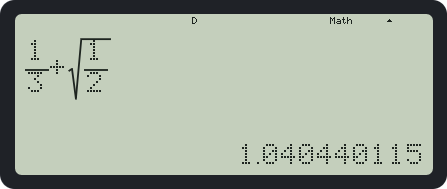

### Decimals

Decimals show 10 significant digits. Very large or very small values use scientific notation, written as `×10` with a raised power. The exact cut-off depends on the Norm setting in [SETUP](#6-setup-display-and-angle-settings).

### Engineering notation

After a result, **ENG** shows it with a power of ten that is a multiple of 3, like `1.234×10³`. Pressing **ENG** again moves the power up by 3, and **SHIFT ENG** moves it down. (In CMPLX mode the ENG key types *i* instead.)

### Degrees, minutes and seconds

- **Typing a sexagesimal angle:** use the **°′″** key after each part, so `1°30°` means 1.5.
- **Converting a result:** press **°′″** after a result to show it as degrees, minutes and seconds, such as `2°15′28.8″`. Press it again to switch back.

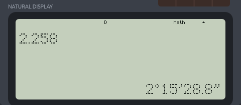

---

## 4. Functions

### Trigonometry and angles

- **Trig functions:** **sin**, **cos** and **tan**, and SHIFT for **sin⁻¹**, **cos⁻¹** and **tan⁻¹**. They use the angle unit set in SETUP.
- **Exact angles:** multiples of 30° and 45°, in any angle unit, give exact answers. sin 30° is `1/2`, cos(π/4) is `√2/2`, and in radians sin⁻¹(1/2) is `π/6`.
- **tan 90°** (or any odd multiple of 90°) is a Math ERROR.
- **Hyperbolic functions:** press **hyp** then **sin**, **cos** or **tan**. Press **hyp**, then **SHIFT**, then the function for the inverse.
- **DRG▸ (SHIFT Ans):** marks a value as degrees (1), radians (2) or grads (3), whatever the current unit is. For example, in radian mode **90 DRG▸ 1 =** gives `π/2`.

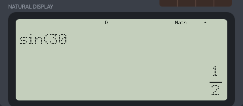

### Powers, roots and logarithms

- **x², x³, x⁻¹ and x^□:** powers. Fractional powers stay exact where possible: `8^(2/3) = 4`.
- **√□, ∛□, ˣ√□:** roots. Odd roots of negative numbers work: `∛(−27) = −3`. A square root of a negative number is a Math ERROR, except in CMPLX mode.
- **log, ln, log□□:** logarithms. They're exact when the answer is a whole number, such as `log 1000 = 3` or `log₂ 8 = 3`. `log(` also accepts a base before a comma: `log(2,8)`.
- **10^□ and e^□:** SHIFT log and SHIFT ln.

### Other functions

| Function | Key | Notes |
|---|---|---|
| Factorial x! | SHIFT x⁻¹ | Whole numbers from 0 to 69 |
| Permutations nPr | SHIFT × | `5P2 = 20`. Needs 0 ≤ r ≤ n < 10¹⁰ |
| Combinations nCr | SHIFT ÷ | `5C2 = 10` |
| Percent | SHIFT ( | `50%` is `1/2` |
| Absolute value | Abs | |
| Polar coordinates | SHIFT + | `Pol(x, y)` gives r and θ. Type the comma with SHIFT ). Must be the whole calculation |
| Rectangular coordinates | SHIFT − | `Rec(r, θ)` gives X and Y |
| Random number | SHIFT . | `Ran#`: a number from 0 to 0.999 in steps of 0.001, shown as a fraction |
| Random integer | ALPHA . | `RanInt#(a, b)`: a whole number from a to b |
| Round | SHIFT 0 | `Rnd(` rounds to what the display shows in the current Fix/Sci/Norm setting |
| π and e | SHIFT ×10ˣ and ALPHA ×10ˣ | |
| ×10ˣ | ×10ˣ | Scientific input: `1 ×10ˣ (−) 3` is `1/1000` |

---

## 5. Memory

### Ans

Every successful calculation is stored in **Ans**, which you can type with the **Ans** key.

### Variables A–F, X, Y and M

**Storing:** press **SHIFT RCL** (STO), then the key for the variable. You don't need ALPHA for this. The variable keys are:

| Variable | Key |
|---|---|
| A | (−) |
| B | °′″ |
| C | hyp |
| D | sin |
| E | cos |
| F | tan |
| X | ) |
| Y | S⇔D |
| M | M+ |

STO stores the result on screen. If you haven't pressed = yet, it calculates the line first.

**Using a variable** in a calculation: press **ALPHA** and its key. For example, ALPHA (−) types `A`.

**Seeing a value:** press **RCL** and the variable's key.

### Independent memory M

**M+** adds the current result to M, and **SHIFT M+** (M−) subtracts it. As with STO, if you haven't pressed = yet, it calculates the line first. The **M** indicator shows while M is not zero.

### Clearing memory

**SHIFT 9** (CLR) offers three choices:

1. **Setup:** resets the settings.
2. **Memory:** clears Ans, the variables and the matrices.
3. **All:** both, plus history, STAT data and the TABLE setup, and returns to COMP mode.

---

## 6. SETUP: display and angle settings

Press **SHIFT MODE** to open SETUP. Choose with the number keys; **▼** shows the second page, and **AC** closes the menu without changing anything.

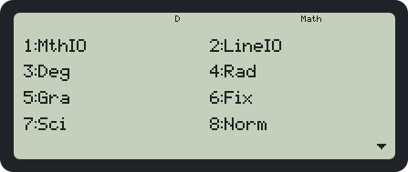

**Page 1:**

| Choice | Effect |
|---|---|
| 1: MthIO | Natural display: templates, stacked fractions, exact forms (the default) |
| 2: LineIO | One-line input and output (see below) |
| 3: Deg / 4: Rad / 5: Gra | The angle unit |
| 6: Fix | Asks for 0–9 decimal places. All decimal results (including whole numbers) show that many places |
| 7: Sci | Asks for 1–10 significant digits (0 means 10). Results are shown in scientific notation |
| 8: Norm | Asks for 1 or 2 (see the next table). Cancels Fix and Sci |

The two Norm settings differ in when they switch to scientific notation:

| Setting | Scientific notation for |
|---|---|
| Norm 1 | values below 10⁻² or from 10¹⁰ up |
| Norm 2 | values below 10⁻⁹ or from 10¹⁰ up |

**Page 2:**

| Choice | Effect |
|---|---|
| 1: ab/c | Shows fractions as mixed numbers, such as 2 1/3 |
| 2: d/c | Shows fractions as improper fractions, such as 7/3 (the default) |
| 3: STAT | Asks whether the STAT editor has a FREQ (frequency) column |
| 4: CMPLX | Asks whether complex results are shown as a+bi or r∠θ |

### LineIO

In LineIO, nothing is drawn as a template:

- **Typing:** the template keys type linear forms instead: `⌟` for fractions (`1⌟2` is ½, and `1⌟1⌟2` is 1 ½), `^(`, `√(`, `ˣ√(` and `Abs(`.
- **Results:** fractions are shown with ⌟, and results that would be roots or π multiples are shown as decimals.

---

## 7. Modes

Press **MODE** to change mode:

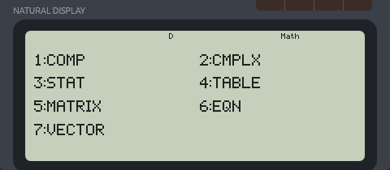

| | Mode | Use |
|---|---|---|
| 1 | COMP | Everyday calculations |
| 2 | CMPLX | Complex numbers |
| 3 | STAT | Statistics and linear regression |
| 4 | TABLE | Tables of f(X) |
| 5 | MATRIX | Matrices |
| 6 | EQN | Solving equations |
| 7 | VECTOR | 2D and 3D vectors |

### 7.1 COMP: everyday calculations

Everything in sections 2–5 works in COMP.

### 7.2 CMPLX: complex numbers

**Typing complex numbers:**
- The **ENG** key types **i**.
- **SHIFT (−)** types **∠** for polar form: `2∠30` is the number with length 2 at 30°. Angles use the current angle unit.

**Exact results:** `2∠30 = √3+i`, `(1+i)² = 2i`, and `(3+4i)÷(1+2i) = 11/5−2/5i`.

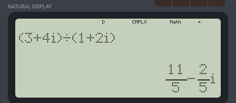

**What works with complex numbers:**
- +, −, ×, ÷, x², x³, x⁻¹, and powers that are whole numbers.
- **Abs** gives the length |z|.
- **√** of a negative number gives an imaginary result: `√(−4) = 2i`.

**What doesn't:** sin, log, ln, and powers like `i^(1/2)` only accept real numbers, and give a Math ERROR for a complex one.

**The CMPLX menu (SHIFT 2):**

| | |
|---|---|
| 1: arg | The angle of a complex number, `arg(1+i) = 45` |
| 2: Conjg | The complex conjugate, `Conjg(1+2i) = 1−2i` |
| 3: ▸r∠θ | At the end of a calculation: show the result in polar form |
| 4: ▸a+bi | At the end of a calculation: show the result in rectangular form |

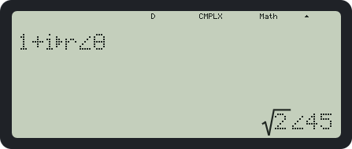

To show every complex result in polar form, choose **SETUP ▼ 4: CMPLX → 2: r∠θ**.

Ans and the variables can hold complex numbers. Watch the order of operations: `1÷2i` means `1/(2i)`, which is `−1/2 i`.

### 7.3 STAT: statistics and regression

**Entering data:**

1. Press **MODE 3**, then choose **1: 1-VAR** for a single list of values, or **2: A+BX** for paired data with the line y = A + Bx.
2. Type each value and press **=**. The cursor moves down. Use the arrows to move between cells and columns.
3. **DEL** on a cell deletes its whole row. A list holds up to 40 rows.
4. Press **AC** when you're done, to go to the calculation screen.

To add a FREQ column for values that occur more than once, turn on **SETUP ▼ 3: STAT**.

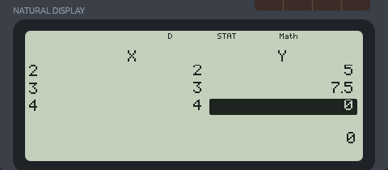

**Using the statistics:** press **SHIFT 1** for the STAT menu, which puts these values into your calculation:

| Menu | Contents |
|---|---|
| 1: Type | Choose 1-VAR or A+BX again (this clears the data) |
| 2: Data | Back to the data editor |
| 3: Sum | Σx², Σx (and Σy², Σy, Σxy) |
| 4: Var | n, x̄, σx (population), sx (sample) (and ȳ, σy, sy) |
| 5: Reg | A, B, r, x̂, ŷ (A+BX only) |
| 5 or 6: MinMax | minX, maxX (and minY, maxY) |

For example, **SHIFT 1 4 2 =** shows the mean x̄. Results stay exact for exact data: the mean of 1, 2, 3, 4 is `5/2`.

**Estimates:** **x̂** and **ŷ** come after a value. `10ŷ` is the estimated y when x is 10, and `21x̂` is the estimated x when y is 21.

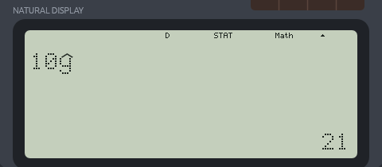

### 7.4 TABLE: tables of values

1. **MODE 4**, then type **f(X)**. Use **ALPHA )** for X. For example, `X²+1`. Press **=**.
2. Answer **Start?**, **End?** and **Step?**, each followed by **=**. Pressing = without typing keeps the value shown (initially 1, 5 and 1).
3. The table appears. ▲/▼ move between rows and ◀/▶ between the X and F(X) columns. The full value of the highlighted cell is shown underneath.
4. **AC** returns to f(X), with your function kept.

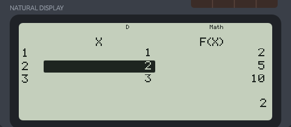

A table can have up to 30 rows; asking for more gives **Insufficient MEM**. A row where f(X) can't be calculated shows **ERROR** without stopping the rest.

### 7.5 MATRIX: matrices

**Setting up a matrix:**

1. Press **MODE 5**. The calculator asks which matrix to set up: **1: MatA**, **2: MatB** or **3: MatC**.
2. Choose its size: 3×3, 3×2, 3×1, 2×3, 2×2 or 2×1. Press **▼** for 1×3, 1×2 and 1×1.
3. Type each cell and press **=**. The cursor moves along the row, then to the next row.
4. Press **AC** when you're done.

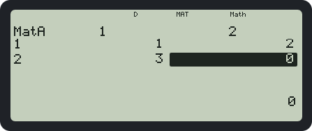

**The MATRIX menu (SHIFT 4):**

| | |
|---|---|
| 1: Dim | Set up or resize a matrix (this clears its cells) |
| 2: Data | Edit a matrix's cells |
| 3–5: MatA, MatB, MatC | Put a matrix in your calculation |
| 6: MatAns | The last matrix result |
| 7: det | The determinant, `det(MatA)` |
| 8: Trn | The transpose, `Trn(MatA)` |

**Operations:**
- **+ and −** between matrices of the same size, and **×** between matrices whose sizes fit together.
- **A number times or divided by a matrix:** `2MatA`, `MatA÷2`.
- **x², x³ and whole-number powers** of square matrices.
- **x⁻¹** for the inverse.
- **Abs** on each cell.

Entries stay exact, so the inverse of [[1, 2], [3, 4]] is `[[−2, 1], [3/2, −1/2]]`.

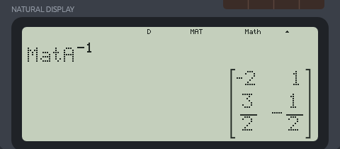

**Where results go:**
- A matrix result is drawn in brackets and becomes **MatAns**.
- A result that is a number, such as `det`, becomes **Ans** as usual.
- Matrices can't be stored in A–F, X, Y or M.

**Errors:**
- **Dimension ERROR:** sizes that don't fit the operation, or a matrix that hasn't been set up.
- **Math ERROR:** inverting a matrix whose determinant is 0.

### 7.6 EQN: equations

**Choosing the equation type:** press **MODE 6**, then choose:

| | Equation | Unknowns |
|---|---|---|
| 1 | aₙX + bₙY = cₙ | 2 equations, 2 unknowns |
| 2 | aₙX + bₙY + cₙZ = dₙ | 3 equations, 3 unknowns |
| 3 | aX² + bX + c = 0 | Quadratic |
| 4 | aX³ + bX² + cX + d = 0 | Cubic |

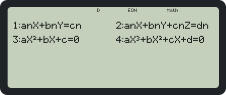

**Solving:**

1. Type each coefficient and press **=**. Each row is one equation, and the columns are a, b, c (and d). A coefficient can be any calculation, like `1/2` or `√3`. The arrows move between cells.
2. Press **=** with nothing typed to solve.
3. The solutions appear one at a time (X, Y, Z for systems; X1, X2, X3 for polynomials):
   - **▼**, or **=**, shows the next one, and **▲** the previous one.
   - **S⇔D** switches between exact and decimal.
   - **=** after the last solution, or **AC**, returns to the coefficients, which are kept.

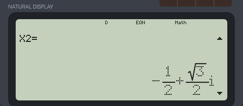

**What to expect:**

- **Linear systems** are solved exactly: 3x = 1, 3y = 2 gives `X = 1/3`, `Y = 2/3`. If there isn't exactly one solution, you'll see **No Solution** or **Infinite Solution**.
- **Quadratics** give exact roots, including roots and complex roots: X² − 2 = 0 gives `±√2`, and X² + 1 = 0 gives `±i`. A double root is shown once, as `X=`.
- **Cubics** are exact when one root is a fraction: X³ − 1 = 0 gives `1` and `−1/2 ± √3/2 i`. Otherwise the roots are decimals, including complex ones.
- **Order of roots:** real roots come first, largest first, then complex roots, with +i first.
- **A first coefficient of 0** in a quadratic or cubic is a Math ERROR.

### 7.7 VECTOR: vectors

**Setting up a vector:**

1. Press **MODE 7**. The calculator asks which vector to set up: **1: VctA**, **2: VctB** or **3: VctC**.
2. Choose its dimension: **1: 3** (3D) or **2: 2** (2D).
3. Type each component and press **=**. The arrows move between components.
4. Press **AC** when you're done.

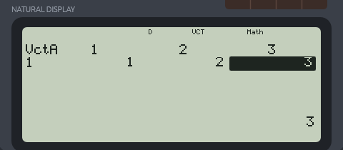

**The VECTOR menu (SHIFT 5):**

| | |
|---|---|
| 1: Dim | Set up a vector, or change its dimension (this clears its components) |
| 2: Data | Edit a vector's components |
| 3–5: VctA, VctB, VctC | Put a vector in your calculation |
| 6: VctAns | The last vector result |
| 7: Dot | The dot product sign `·`, as in `VctA·VctB` |
| 8: Angle | The angle between two vectors, `Angle(VctA,VctB)` |

**Operations:**
- **+ and −** between vectors of the same dimension.
- **A number times or divided by a vector:** `2VctA`, `VctA÷2`.
- **Dot product:** `VctA·VctB` gives a number.
- **Cross product:** `VctA×VctB`. The cross product of two 2D vectors is the 3D vector (0, 0, z).
- **Length:** `Abs(VctA)`. Lengths stay exact, so the length of (1, 2, 3) is `√14`.
- **Angle:** `Angle(VctA,VctB)`, in the current angle unit. Special angles are exact, so (1, 0) and (1, 1) give `45` in degrees.

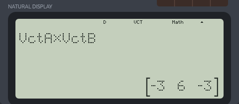

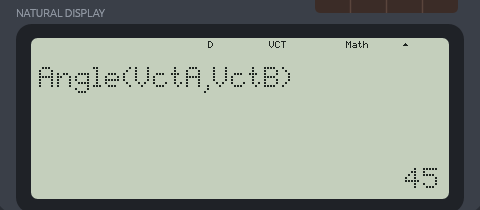

**Where results go:**
- A vector result is drawn in brackets and becomes **VctAns**.
- A result that is a number, such as a dot product, length or angle, becomes **Ans** as usual.
- Vectors can't be stored in A–F, X, Y or M.

**Errors:**
- **Dimension ERROR:** mixing 2D and 3D vectors, or using a vector that hasn't been set up.
- **Math ERROR:** adding a number to a vector, dividing by a vector, or the angle with a zero vector.

---

## 8. Error messages

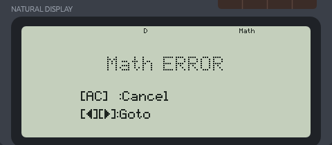

| Message | Cause |
|---|---|
| **Math ERROR** | A result out of range (10¹⁰⁰ or more), division by zero, or a value a function can't take, such as √ of a negative number, log 0, tan 90° or 70! |
| **Syntax ERROR** | The calculation isn't written correctly, such as `1+` or a missing number |
| **Stack ERROR** | More than 24 nested parentheses, functions or templates |
| **Dimension ERROR** | Matrix or vector sizes that don't fit, or a matrix or vector that hasn't been set up |
| **Insufficient MEM** | A TABLE of more than 30 rows, or more than 40 rows of STAT data |
| **Argument ERROR** | An argument the command can't use |

On an error screen, **AC** clears the line, and **←** or **→** returns to the calculation with the cursor where the error was found.

---

## 9. Saved state and resetting

**What's saved:** SciCalc 82 remembers these between sessions, like the real calculator does when switched off:
- the settings
- Ans and the variables
- the current mode
- STAT data, the TABLE setup, the matrices, the vectors and the EQN coefficients

The line you were typing and the history are not kept.

**Where it's saved:**
- **Windows:** `%APPDATA%\scicalc82\data\app.ron`
- **Web:** the browser's local storage for the page

If the saved file is damaged, the calculator starts with defaults rather than failing.

**To reset everything,** use **SHIFT 9 → 3: All**.

---

## 10. Key reference

| Key | Pressed alone | With SHIFT | With ALPHA |
|---|---|---|---|
| MODE | MODE menu | SETUP | |
| ON | Same as AC | | |
| Abs | Absolute value | | |
| x³ | Cube | | |
| x⁻¹ | Reciprocal (matrix inverse in MATRIX) | x! | |
| log□□ | Log to any base | | |
| □/□ | Fraction | Mixed fraction | |
| √□ | Square root | Cube root | |
| x² | Square | | |
| x^□ | Power | ˣ√□ | |
| log | log( | 10^□ | |
| ln | ln( | e^□ | |
| (−) | Negative sign | ∠ (CMPLX) | A |
| °′″ | Degrees/minutes/seconds | | B |
| hyp | Hyperbolic | | C |
| sin / cos / tan | Trig functions | Inverse trig | D / E / F |
| RCL | Recall a variable | STO | |
| ENG | Engineering notation (i in CMPLX) | ENG down | |
| ( | ( | % | |
| ) | ) | , (comma) | X |
| S⇔D | Exact ⇔ decimal | | Y |
| M+ | Add to M | M− | M |
| 0 | 0 | Rnd( | |
| 1 | 1 | STAT menu (STAT) | |
| 2 | 2 | CMPLX menu (CMPLX) | |
| 4 | 4 | MATRIX menu (MATRIX) | |
| 5 | 5 | VECTOR menu (VECTOR) | |
| 9 | 9 | CLR | |
| . | Decimal point | Ran# | RanInt#( |
| × / ÷ | Multiply / divide | nPr / nCr | |
| + / − | Add / subtract | Pol( / Rec( | |
| ×10ˣ | Powers of ten | π | e |
| Ans | Ans | DRG▸ | |
| = | Calculate | Calculate to a decimal | |
| DEL / AC | Delete / clear | | |
| ▲ ▼ ◀ ▶ | Cursor and history | | |

---

## 11. PC keyboard shortcuts

You can type on the PC keyboard instead of clicking. Hovering over the model name shows this list in the app.

| Keys | Do |
|---|---|
| `0`–`9` `.` `+` `-` `*` `/` `(` `)` | The same keys |
| `^` | Power (x^□) |
| `=` or Enter | = |
| Backspace | DEL |
| Esc or Delete | AC |
| Arrow keys | Cursor and history |
| `s` `c` `t` | sin, cos, tan |
| `S` `C` `T` | sin⁻¹, cos⁻¹, tan⁻¹ |
| `h` | hyp |
| `l` `n` | log, ln |
| `r` | √ |
| `q` | x² |
| `f` | Fraction |
| `!` | x! |
| `%` | % |
| `,` | Comma |
| `p` | π |
| `e` | e |
| `E` | ×10ˣ |
| `a` | Ans |
| `d` | S⇔D |
| `m` | M+ |
| `i` | The ENG key: *i* in CMPLX mode |
| `<` | ∠ (CMPLX mode) |
| Ctrl+C | Copy the result |

---

## 12. Specifications

| | |
|---|---|
| Displayed digits | 10 significant digits |
| Internal precision | 15 significant digits |
| Range | 10⁻⁹⁹ ≤ \|x\| < 10¹⁰⁰ (smaller values become 0) |
| Input length | 99 items, templates nested up to 7 deep |
| Nesting | Up to 24 levels of parentheses and functions |
| History | The last 30 calculations |
| Factorial | 0! to 69! |
| nPr, nCr | 0 ≤ r ≤ n < 10¹⁰ |
| Trig arguments | Less than 9×10⁹ degrees (or the same angle in radians or grads) |
| STAT data | Up to 40 rows |
| TABLE | Up to 30 rows |
| Matrices | Up to 3×3; MatA, MatB, MatC and MatAns |
| Vectors | 2D or 3D; VctA, VctB, VctC and VctAns |
| Equations | 2 or 3 linear unknowns; quadratic and cubic polynomials |
